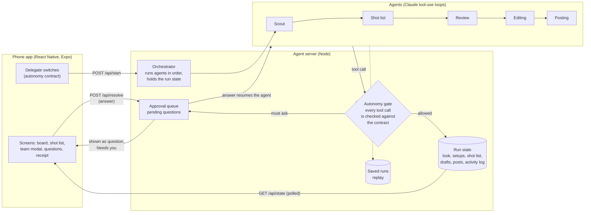

# Crew

**[Watch the demo video](https://drive.google.com/file/d/1NnmkfI1Y27lga_HEn0Dg2FCOG_KvvSRT/view?usp=sharing)** (3 min)

One photographer. A full crew.

Crew gives a solo photographer a team of AI agents that plan a shoot, check it, edit it and post it. The photographer sets once how hands-on they want to be, and the agents follow that contract for the whole project: they do the work they are allowed to do, and stop to ask only where the photographer said to ask.

## What the app does

1. **Set the contract.** On the Delegate screen the photographer chooses what the agents must ask before doing: posting anything, reshooting a shot, spending money, changing the look. Everything else the agents just do.
2. **Add references.** The photographer drops reference photos onto the project board.
   A short chat with the Planning agent sets how the photos should feel; the answer is passed to the Shot list and Posting agents.
3. **Scout reads the look.** The Scout agent looks at the photos and returns the look as five tags (light, colour, scale, composition), then sorts the photos into three setups for the shoot.
4. **The shot list is drafted.** The Shot list agent turns the look and the setups into an eight-shot list, grouped by setup, and waits for approval.
5. **Shoot.** Each setup has a brief with its shots and a lighting note.
6. **Review checks coverage.** The Review agent compares the shoot report with the shot list. If a must-have shot has no usable take it requests a reshoot, which the contract may require the photographer to approve. The question comes with three answers: reshoot, use the closest photo, or skip the shot.
7. **Editing picks takes.** The Editing agent chooses takes on its own and asks only when two takes are near-identical and the choice is a matter of taste.
8. **Review approves the edit** against the look. If it does not approve, nothing is posted.
9. **Posting drafts and publishes.** The Posting agent writes a caption and picks a photo for each channel (Instagram, TikTok, email, product page). With "Posting anything" switched on, the photographer holds to post; with it off, the agent publishes directly.
10. **Receipt.** The Posted screen lists every post with its channel, caption and photo.

### Watching and steering the agents

- **Team modal.** Tapping the agent pill in the header opens the team from the project screens: each agent's status (Waiting, Working, Needs you, Done), what it last did, and any question it is waiting on.
- **"You can go."** While the agents work, this screen shows the three agents that matter right now with live progress, so the photographer can put the phone down.
- **Questions come with reasons.** When an agent needs a decision it says what is missing and why it is asking.

### Two ways to run a project

| Contract | What happens |
|---|---|
| Any switch on | The agents pause at each action the photographer asked to approve: the shot list, a reshoot, a taste call on a take, posting. |
| Every switch off | Hands-off. The agents plan on their own and hand the photographer a locked shot list to shoot from. After the shoot they finish through to posted without asking anything. |

## The crew

| Agent | Job | Acts through |
|---|---|---|
| Planning | Records the autonomy contract; talks through the vision with the photographer | chat reply |
| Scout | Reads the reference photos; reports the look and the setups | `report_look`, `group_photos` |
| Shot list | Drafts the eight-shot list | `draft_shot_list` |
| Review | Checks shoot coverage, then approves the edit against the look | `request_reshoot`, `approve_edits` |
| Editing | Picks takes; asks on taste calls | `ask_user` |
| Posting | Writes captions, picks photos, publishes per channel | `post` |

Each agent is a Claude tool-use loop (`claude-opus-5-5`). Scout receives the reference photos as images.

## How it works



**The autonomy gate is the core of the product.** Agents never perform a side effect directly. Every action is a tool call, and every tool call passes through one function on the server that checks it against the photographer's contract:

- If the contract allows it, the action runs and is written to the activity log.
- If the contract says "ask me before", the agent is paused, the question goes into the approval queue, and the phone shows it (as a question screen and a "Needs you" status in the team modal). The photographer's answer is returned to the agent as the tool result, and the agent carries on with that answer.

Because the gate sits in the server and not in the agents' prompts, an agent cannot talk itself past it.

**Run state.** The server keeps one run: the contract, each agent's status, the look, setups, shot list, drafted and published posts, pending questions and the activity log. The phone polls this state and draws the agent-produced parts of each screen from it.

**Replay.** Every finished agent run is saved under `saved-runs/`. If a model call fails, or the server is started with `REPLAY=1`, the saved run is replayed through the same gate, so approvals behave identically.

**This build's data.** The app ships with the Girlhood eyewear project: ten reference photos and its shoot report. The `post` tool records each post in the run state and the receipt.

## Run it

Requirements: Node 22 or later, Xcode with an iOS Simulator, an Anthropic API key.

Start the agent server from the repository root:

```bash
npm install
echo "ANTHROPIC_API_KEY=your-key" > .env
npm start
```

Start the app in a second terminal:

```bash
cd mobile
npm install
npm run ios
```

The app talks to the server at `http://localhost:4173`. Set `EXPO_PUBLIC_API_URL` to point it somewhere else.

## Project layout

```
server.js        Agent server: orchestrator, agents, tools, autonomy gate, HTTP API
photos/          Reference photos Scout reads
saved-runs/      Last finished run of each agent, used for replay
mobile/
  App.js         Navigation: setup steps, then the screen follows the run's state
  src/api.js     Server client and polling hook
  src/components.js   Shared UI: agent pill, team modal, buttons, photo stacks
  src/screens/   Setup (studio, contract, board, vision), Plan (look, shot list, brief), Run (working, questions, posts, receipt)
  images.js      Bundled reference photos
  assets/        Reference photos, app icons
```

## API

| Endpoint | Purpose |
|---|---|
| `POST /api/start` `{ askBefore }` | Start a run under the given contract |
| `POST /api/resolve` `{ id, answer }` | Answer a pending question or signal a step (`photos`, `shotlist`, `shoot`, `reshoot`, `take`, `post`) |
| `POST /api/chat` `{ message }` | Say something to the Planning agent on the vision screen |
| `GET /api/state` | Current run: agents, pending questions, outputs, activity log |
